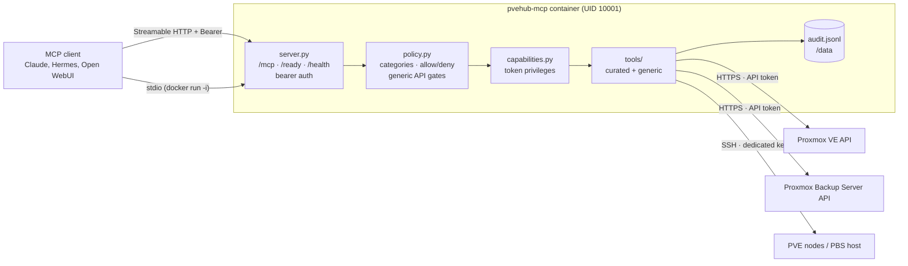

# PVEHub-MCP

One MCP server for **Proxmox VE** and **Proxmox Backup Server**, plus shell access to PVE
hosts, LXC containers, QEMU VMs (guest agent) and the PBS host.

> Status: `0.1.3` — core server, policy engine, curated PVE/PBS/exec tools and packaging are
> implemented. `docs/TOOLS.md` is generated from the code and shows exactly what exists today;
> `docs/STATUS.md` separates live-verified, mocked and untested behaviour.

## Features

- **PVE REST API** — curated tools plus a generic `pve_api_schema` / `pve_api_call` bridge
  for every endpoint the token can reach.
- **PBS REST API** — datastores, namespaces, snapshots, prune, GC, verify, jobs, tasks, plus
  a generic bridge.
- **Shell** — QEMU guest agent, LXC via `pct exec`, host and PBS host via SSH (opt-in).
- **Rights-aware** — token permissions are discovered at startup; tools without the required
  privilege are not registered, and each call is pre-checked.
- **Blockable** — every tool and category can be denied via YAML/env policy; denied tools do
  not appear in `tools/list`.
- **Memory** — `memory_recall` / `memory_remember` / `memory_forget` on a local SQLite
  file, plus metadata history of mutating calls and a `_memory` context block on tool
  results (see [Memory layer](docs/CONFIGURATION.md#memory-layer)).
- **One container, one endpoint** — Streamable HTTP at `/mcp` (bearer), `GET /ready`
  readiness (bearer), unauthenticated `GET /health` liveness, optional stdio.

## Architecture



## Quickstart

```bash
git clone https://git.mls4tech.net/admin/PVEHub-MCP.git
cd PVEHub-MCP
cp .env.example .env
# edit .env: PVE/PBS URLs, token IDs/secrets, PVEHUB_MCP_AUTH_TOKEN
mkdir -p config ssh
cp config/examples/operator.yaml config/policy.yaml
docker compose up -d --build
curl -s http://127.0.0.1:8080/health   # liveness: {"status":"ok"}
```

`GET /health` is a minimal liveness probe — no version, no tool count, no backend state.
The readiness signal is the authenticated `GET /ready` endpoint: same bearer as `/mcp`,
full health body, HTTP `503` while any backend is degraded. The container healthcheck
runs exactly that probe (see `docs/CONFIGURATION.md` and `docs/DECISIONS.md` D021).

`docker compose` reads `.env`, mounts `./config` and `./ssh` read-only, keeps `/data`
(audit log, caches) in the named volume `pvehub-data`, runs the container read-only with
all capabilities dropped, and publishes `8080` on all interfaces. Bind it to LAN/VPN only:
put a TLS reverse proxy in front of it, or change the port mapping to
`127.0.0.1:8080:8080` and proxy from the same host.

The API token needs the privileges of the tools you want to use. Start read-only:

```
PVE:  Datastore.Audit, Sys.Audit, VM.Audit
PVE (exec/files): VM.GuestAgent.Unrestricted, VM.GuestAgent.FileRead, VM.GuestAgent.FileWrite,
                  VM.GuestAgent.Audit
PBS:  Datastore.Audit, Sys.Audit
```

Then widen the token ACL and restart the server. `pvehub_capabilities` shows what is
available, what policy blocks and what the token is missing.

## Clients

The server speaks **Streamable HTTP** at `http://<host>:8080/mcp` with
`Authorization: Bearer <PVEHUB_MCP_AUTH_TOKEN>`; the http
transport **refuses to start without** `PVEHUB_MCP_AUTH_TOKEN` (any bind
address). `PVEHUB_MCP_AUTH_REQUIRED=false` is an explicit opt-out for loopback
development setups only (warning logged at startup). Or **stdio** when started
with `--transport stdio` / `PVEHUB_TRANSPORT=stdio` (no listener, no bearer
token).

### Bearer pass-through (D026, issue #30)

In the default (`static`) mode the server authenticates clients with named MCP
tokens and calls PVE with one configured service token. With
`PVEHUB_MCP_AUTH_MODE=passthrough` (opt-in) that flips: the
`Authorization: Bearer` value **is** the client's own PVE API token
(`user@realm!tokenid=<secret>`), and the server uses it as the credential for
every PVE call of that request — no configured service token, fail-closed. The
token is validated once per request-identity against the PVE API (cached, TTL),
PVE keeps enforcing the caller's own ACL per call, and the audit log records the
token **identity** (never the secret) in a `pve_token` field. PBS tools are not
registered in this mode (a PVE API token is not a PBS credential; run static
mode for PBS). It requires a PVE instance, the `http` transport,
`PVEHUB_MCP_AUTH_REQUIRED=true`, and `PVEHUB_MCP_TOKEN_VALIDATION_TTL >= 1`.
See `docs/DECISIONS.md` D026 and `docs/CONFIGURATION.md`.

### Claude Code / generic HTTP client

```bash
claude mcp add --transport http pvehub http://127.0.0.1:8080/mcp \
  --header "Authorization: Bearer $PVEHUB_MCP_AUTH_TOKEN"
```

Generic client entry (Claude Code `.mcp.json`, Cursor and similar):

```json
{
  "mcpServers": {
    "pvehub": {
      "type": "http",
      "url": "http://127.0.0.1:8080/mcp",
      "headers": { "Authorization": "Bearer <token>" }
    }
  }
}
```

### Claude Desktop (stdio via Docker)

Claude Desktop launches stdio servers itself. Run the same image with `-i` and no port:

```json
{
  "mcpServers": {
    "pvehub": {
      "command": "/usr/local/bin/docker",
      "args": [
        "run", "-i", "--rm",
        "--env-file", "/Users/you/pvehub/.env",
        "-e", "PVEHUB_TRANSPORT=stdio",
        "-v", "/Users/you/pvehub/config:/config:ro",
        "-v", "/Users/you/pvehub/ssh:/ssh:ro",
        "-v", "pvehub-data:/data",
        "pvehub-mcp:0.1.3"
      ]
    }
  }
}
```

Use the absolute path to `docker` (GUI apps often have a minimal `PATH`) and absolute host
paths for the mounts. Docker Desktop must be running. `-v pvehub-data:/data` creates a
volume of that name, separate from the compose volume (`<project>_pvehub-data`); point both
at the same host directory if they should share audit/cache state. The image's HTTP
healthcheck does not apply here; ignore the container health status in stdio mode.

### Hermes

`~/.hermes/config.yaml`:

```yaml
mcp_servers:
  pvehub:
    url: "http://127.0.0.1:8080/mcp"
    headers:
      Authorization: "Bearer ${PVEHUB_MCP_AUTH_TOKEN}"
```

Hermes expands `${VAR}` in `url`/`headers`; keep the token in the environment, not in the
file. For stdio, use `command: docker` with `args: ["run", "-i", "--rm", ...]` and
`env: { PVEHUB_TRANSPORT: "stdio" }` instead of `url`.

### Open WebUI

Admin Settings → Integrations → **External Tool Servers** → **+ Add Connection**:

- Type: **MCP (Streamable HTTP)**
- URL: `http://<docker-host>:8080/mcp`
- Auth: bearer token (`PVEHUB_MCP_AUTH_TOKEN`)

Open WebUI calls the tools through its backend, so the URL must be reachable from the
Open WebUI container, not just from your browser (use the LAN address or a shared Docker
network, not `127.0.0.1`).

## SSH access (optional)

Shell tools are the highest-risk part of the server. Host and PBS shells are disabled by
default (`exec.host: false`, `exec.pbs_host: false`); LXC and VM exec are enabled but
still require `confirm=true` and a VMID inside `exec.allowed_vmids`.

Minimum setup:

```bash
# 1. Dedicated key, no passphrase (it lives in the container)
ssh-keygen -t ed25519 -C pvehub-mcp -f ssh/id_ed25519 -N ''

# 2. Host keys, verified out of band before trusting them
ssh-keyscan -H 10.0.0.11 10.0.0.12 10.0.0.20 >> ssh/known_hosts
ssh-keygen -lf ssh/known_hosts        # compare with the node consoles

# 3. UID 10001 must be able to read the key
chown -R 10001:10001 ssh && chmod 700 ssh && chmod 600 ssh/id_ed25519 ssh/known_hosts
```

On every node, create a dedicated user, install the public key and map the PVE node name
to its address in `config/config.yaml`:

```yaml
ssh:
  nodes:
    pve1:
      host: 10.0.0.11
    pve2:
      host: 10.0.0.12
      sudo: true          # pct exec via passwordless sudo
  pbs:
    host: 10.0.0.20
```

Notes:

- The `nodes` key must be the **PVE node name**, not the hostname.
- `pct exec` needs root or passwordless sudo for `/usr/sbin/pct`; `sudo: true` runs
  `sudo -n pct exec ...`, so a missing NOPASSWD rule fails immediately instead of hanging.
- Keep `strict_host_key: true`. `known_hosts` must exist or the shell tools stay hidden.
- `authorized_keys` **cannot** use `command="..."` restrictions: the MCP server sends
  arbitrary commands (host shell, `pct exec` with a variable VMID). A forced command would
  break every call. Restrict by key (`from="10.0.0.20"`), a dedicated user, firewall rules
  and the policy instead. `restrict` (no forwarding, no agent, no pty) is fine.
- Revoke by removing the key from `authorized_keys`; the MCP server reconnects with the
  key on the next call.

## Memory (optional, on by default)

The server remembers notes and *what happened to which guest/node/datastore*, without
becoming a second audit log:

- `memory_remember` stores a note for `guest`, `node`, `datastore`, `cluster`,
  `convention` or `runbook` (`title`, `tags`, optional `expires_in_days`).
  `memory_forget` tombstones it and requires `confirm=true`.
- `memory_recall` searches the notes (FTS5, `LIKE` fallback) and returns the last
  recorded actions for a subject.
- Mutating calls are recorded as **metadata only** — no guest output, and for `exec`
  only `command_sha256` and the command length, never the command itself.
- Successful tool results get a `_memory` block labelled `trust: "untrusted-data"`;
  errors and memory tools never do, and a failed enrichment never changes a result.
- Read-only profiles keep recall and enrichment; `categories.deny: [memory]` removes the
  feature entirely. Notes and the action history live in `/data/memory.db` (SQLite,
  `0600`, no extra service) and are cleaned up by TTL, retention and a note cap.

Everything is configurable (`PVEHUB_MEMORY_*`, see `docs/CONFIGURATION.md`), and a
read-only `/data` disables the layer with a reported reason instead of failing the start.

## Security (short version)

- Bind the MCP port to LAN/VPN only; put TLS in front of it (reverse proxy).
- Behind a reverse proxy: set `PVEHUB_TRUSTED_PROXIES` to the proxy's network(s)
  and `PVEHUB_REQUIRE_TRUSTED_PROXY=true` to reject direct (non-proxy) access with
  `403` before authentication, and to get the real client IP in the audit log
  (`client_ip`) — see `docs/DECISIONS.md` D024 (issue #25). Keep the trust set
  tight; a broad set (e.g. `0.0.0.0/0`) re-opens the `X-Forwarded-For` forgery
  window.
- The http transport **refuses to start without `PVEHUB_MCP_AUTH_TOKEN`** (any
  bind address). `PVEHUB_MCP_AUTH_REQUIRED=false` is an explicit, logged
  opt-out for loopback development setups only; a non-loopback bind without a
  token is refused even with the opt-out.
- Health endpoints: `GET /health` is an unauthenticated **liveness** probe
  (`{"status": "ok"}` only — no version, no tool count). `GET /ready` is the
  **readiness** endpoint: authenticated with the same bearer as `/mcp`, full health
  body, HTTP `503` while any backend is degraded. Container and external readiness
  monitors must use `/ready` with the token (see `docs/DECISIONS.md` D021).
- Use a dedicated PVE/PBS API token with the minimum ACLs and no expiry surprises.
- Start with `config/examples/readonly.yaml`; widen to `operator.yaml` when needed.
  `admin.yaml` (destructive + host shells) is for trusted single-operator setups only.
- Shell access: dedicated SSH key, `known_hosts` verification, `exec.host` and
  `exec.pbs_host` stay `false` unless you really need them.
- Destructive and exec tools require `confirm=true`; destructive tools support `dry_run`
  where the API does.
- The generic API bridge always denies ticket/console endpoints (`/access/ticket`,
  token endpoints, `vncshell`, `spiceshell`, `termproxy`, QEMU `monitor`) and the
  guest-agent `exec`/`file-write` endpoints; use `exec_vm` / `file_write_guest` for those.
  Non-GET generic calls require `confirm=true`.
- Audit JSONL is written to `/data/audit.jsonl` with secret redaction; result bodies are
  opt-in (`PVEHUB_AUDIT_INCLUDE_RESULTS=true`).
- The container runs as UID 10001, read-only root filesystem, `cap_drop: ALL`,
  `no-new-privileges`.

## Troubleshooting

| Symptom | Cause / fix |
|---|---|
| `refusing to bind a non-loopback address without mcp_auth_token` | Set `PVEHUB_MCP_AUTH_TOKEN` (non-empty) or bind to `127.0.0.1` |
| `mcp_auth_token is required for the http transport` | Set `PVEHUB_MCP_AUTH_TOKEN` (see `docs/CONFIGURATION.md`), or `PVEHUB_MCP_AUTH_REQUIRED=false` for loopback development setups |
| `configuration error: ... extra_forbidden` | Unknown YAML key; compare with `docs/CONFIGURATION.md`. `extra="forbid"` is intentional |
| `policy error: ... invalid policy` | Unknown category or key in `policy.yaml`; valid categories are `read`, `lifecycle`, `write`, `destructive`, `exec`, `generic` |
| `401 unauthorized` on `/mcp` or `/ready` | Missing/wrong `Authorization: Bearer *** header |
| `421 Invalid Host header` or DNS-rebinding error | Set `PVEHUB_ALLOWED_HOSTS` to the hostnames clients use (including port if non-default) |
| `docker compose` complains about `.env` | `cp .env.example .env` first; compose requires the file |
| Tool missing from `tools/list` | Policy deny, category deny, missing token privilege, missing SSH target/key, or `exec.host`/`exec.pbs_host` disabled. Ask `pvehub_capabilities` for `tools.blocked` reasons |
| `GET /ready` returns `503` (`degraded`) | Capability discovery failed for at least one instance (bad/revoked token, API unreachable); the server still serves tools per `capabilities_fail_open`, but the container healthcheck marks the container `unhealthy`. Check logs and token ACLs |
| SSH `key not found` / `known_hosts not found` | Wrong mount path, wrong UID/permissions, or missing `ssh.nodes` entry for the node |
| `sudo: a password is required` | `sudo: true` is set but no NOPASSWD rule for `pct` exists on the node |
| Container `unhealthy` while using stdio | Expected: there is no HTTP listener, so the `/ready` probe cannot succeed. Harmless for `docker run -i` |
| Changes to policy/token ACLs have no effect | Settings and policy are read at startup; restart the container |

## Documentation

| Document | Content |
|---|---|
| `docs/ARCHITECTURE.md` | components, request pipeline, why SSH is needed |
| `docs/CONFIGURATION.md` | every environment variable and YAML key, precedence, TLS, policy, audit |
| `docs/TOOLS.md` | generated tool catalog with categories and privileges |
| `docs/DECISIONS.md` | design decisions and trade-offs |
| `docs/PLAN.md` | phase plan |
| `docs/REUSE_AUDIT.md` | reference projects, licenses, what was reused |

## Development

```bash
make install        # uv sync --extra dev
make check          # ruff + mypy + pytest
make docs-tools     # regenerate docs/TOOLS.md from @hub.tool declarations
make docker-build   # docker build -t pvehub-mcp:0.1.3 .
```

The Docker image is built by CI (`.gitea/workflows/ci.yml`); the development sandbox has
no Docker daemon, so the image build is not executed there (see `docs/DECISIONS.md` D010).

## License

MIT — see `LICENSE`. Third-party inspiration: `THIRD_PARTY.md`.
